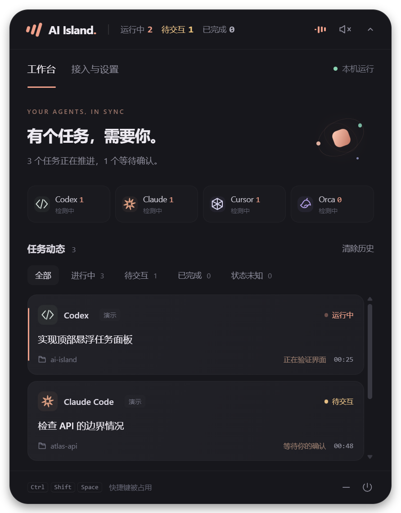

# AI Island

**English** | [简体中文](README.zh-CN.md)

A floating Windows task monitor for Codex, Claude Code, Cursor and Orca. Track running tasks, see what needs your input, and hear when work finishes.

AI Island sits at the top of your screen as a compact pill. Expand it to view tasks by session, filter by tool or status, and adjust notifications. Task cards keep their order as activity updates arrive. Codex and Claude tasks launched through Orca appear under Orca.



## Download and run

Download the Windows x64 portable ZIP from [GitHub Releases](https://github.com/kunpengdai/ai-island/releases/latest), extract the entire archive, and run `AI Island.exe`. Keep the other files alongside the executable. The portable app does not require Node.js. Windows is currently the only supported platform; the app interface is in Simplified Chinese.

Local builds produce `release/AI-Island-0.1.4-win-x64/AI Island.exe` and `release/AI-Island-0.1.4-win-x64.zip`. Upgrading from Agent Island preserves existing integrations, settings and history.

For development, install Node.js 22 or newer:

```powershell
npm ci
npm start
```

Click the pill to expand or collapse it. Drag the icon on the left to move the window. `Ctrl+Shift+Space` toggles the panel, and `Esc` collapses it. The system tray menu lets you restore the window, reset its position or quit. Settings include display selection, volume, always-on-top behavior, system notifications and launch at login. Launch at login is available in packaged builds; enable it again after moving the portable app.

## Task overview

The compact window always shows **running**, **waiting for input** and **completed** counts. Running excludes tasks waiting for input. Completed tasks remain counted until you clear history or the session starts another turn. The expanded panel has a dedicated waiting-for-input filter.

Tasks whose current state cannot be confirmed appear in a separate **unknown** category with its own count. In the All view, they form a section at the bottom. They do not count as running, waiting or completed. A fresh, reliable event restores the appropriate state.

Running task cards retain their order and identity: activity and elapsed-time updates change the existing cards without rebuilding or reordering the list. Click a tool card to filter its tasks; click it again to show all tools. Tasks launched through Orca belong to **Orca**, with the underlying agent type shown on each task card.

## Connect your tools

| Tool | Integration | Setup |
| --- | --- | --- |
| Orca | Polls the local `orca worktree ps --json` command every 3 seconds | Open Orca; local terminal-agent states sync automatically. |
| Codex Desktop | Reads desktop-session lifecycle records from `~/.codex/sessions` | Automatic: no hooks, restart or interruption of existing tasks required. Reads new records every second and discovers sessions every 5 seconds. |
| Codex CLI | User-level `~/.codex/hooks.json` | Click 接入 (Connect) in 接入与设置 (Integrations & Settings), restart Codex, then review and trust the added Island hooks in `/hooks`. |
| Claude Code | User-level `~/.claude/settings.json` | Click 接入 (Connect), restart Claude Code, and review the hooks in the tool if prompted. |
| Cursor | User-level `~/.cursor/hooks.json` | Click 接入 (Connect), restart Cursor, and start a local Agent conversation. |
| Cursor Cloud / Background Agent | Cursor Cloud Agents API v1 | Enter an API key from your Cursor dashboard in the cloud connection section; tasks sync after validation. |

Installing or removing hooks saves a timestamped `.island-backup-*` file beside the original configuration. Installation merges the hooks into existing settings. Removal deletes only Island's hooks and preserves other settings and hooks. Invalid JSON is never overwritten. The current implementation uses each tool's default configuration directory; separate profiles, `CODEX_HOME`, `CLAUDE_CONFIG_DIR`, WSL and custom installation paths need additional adaptation.

Codex and Claude sessions inside Orca are grouped under Orca and labeled with their actual agent type. Hooks carrying Orca pane/worktree identifiers merge into the same task. Standalone sessions use their own session IDs, so multiple sessions of one tool can appear together. Recent, explicit completion states remain visible after a terminal exits.

An installed hook configuration only means the integration is ready to receive events. Hook-based integrations show Connected after receiving an event; the desktop adapter shows Connected after finding a valid desktop session. A detected process does not imply an active task. AI Island does not scan your screen or simulate keyboard input.

### Codex Desktop

The desktop compatibility adapter reads local JSONL files, recognizes Codex Desktop / vscode origins, and excludes CLI sessions and subagents to avoid duplicating Orca tasks. Explicit lifecycle events determine start, completion, failure and interruption; an assistant message alone does not end a task. Blocking `request_user_input` calls become Waiting for input and resume when their matching answer arrives. Permission dialogs absent from the logs cannot currently be identified reliably. Session logs are not a stable public API, so future Codex updates may require adapter changes.

### Cursor local and cloud tasks

Local readiness means the Cursor process and hooks are available; a new task must emit an event to confirm task monitoring. Cloud / Background Agents run remotely and do not trigger Windows hooks.

Cloud monitoring uses the [official Cursor API](https://cursor.com/docs/cloud-agent/api/endpoints). It makes GET requests every 10 seconds to sync existing agents and their latest runs. Only a run with status `FINISHED` counts as completed. Errors, cancellations and expiry are handled separately; an agent being `IDLE` is not treated as success. Waiting for background work remains Running because the cloud API does not currently expose an explicit waiting-for-user-input state.

The cloud API key is used only in the main process and encrypted with Windows credential protection before being saved as `cursor-cloud-key.bin` in the user-data directory. It is never returned to the renderer or included in task history. Disconnecting cloud monitoring deletes the saved key. Connection errors produce an unknown task state and no completion sound. Provide your own key in the app to connect real cloud tasks.

## States and notifications

- **Starting:** the user submits a task.
- **Running:** a tool emits activity or Orca reports a working state.
- **Waiting for input:** an explicit permission or interaction request is received. Cursor currently reports start, tool activity and stop events; permission waits cannot always be identified.
- **Completed:** an explicit Stop / stop event or Orca done state is received. The chime plays only when a previously observed active task becomes completed.
- **Failed / Interrupted:** the tool explicitly reports failure or interruption; no success chime plays.
- **Unknown:** the connection drops, a session disappears, an unrecognized state arrives, or a standalone hook has been silent for 30 minutes. Success is never inferred; fresh events can restore tracking.

Replayed events at startup and the initial Orca snapshot do not play sounds. Duplicate completion events do not chime again. The app synthesizes its chime with Web Audio; you can mute it or adjust the volume. System notifications are off by default. Demo tasks are labeled 演示 (Demo) and are not saved as real history.

The Orca adapter depends on terminal-agent / live-PTY fields in the CLI response. Embedded chat, remote and cloud tasks without those fields are not considered supported. Your coding tools continue to work when Island is closed. Hooks only write local events; they do not wait for Island or influence tool decisions.

## Local data and privacy

Hook scripts and temporary events live in `%LOCALAPPDATA%\AgentIsland`; no network listener is required. Events contain the tool, session ID, status, working directory, model, tool name and a task title of at most 160 characters. Tool arguments, tool output and full conversations are not stored. Events are deleted after consumption, and expired events are ignored. Events generated while the app is closed stay locally until the next startup.

For new installations, settings and up to 80 inactive tasks are saved in `%APPDATA%\AI Island`. If the old `%APPDATA%\Agent Island` directory exists, the app continues using it to preserve settings and history. The hook runtime keeps the `AgentIsland` directory name so existing hooks keep working without reinstallation.

The desktop adapter parses logs locally and retains only session identifiers, status, timestamps, directories and short task titles. It does not retain conversation bodies or tool arguments. Clear history removes inactive tasks, and the next poll will not reintroduce those old states. After removing the integrations, you can delete the local data directories yourself. Task titles may include text you entered, so treat history as local project data.

AI Island has no telemetry and does not upload local tasks. Orca integration invokes the local CLI. Explicitly connecting Cursor cloud monitoring sends requests to the official Cursor API. Public source and portable builds do not include developer tool configurations, task history, logs or credentials.

## Development and validation

```powershell
npm test       # State handling, disconnects, duplicate events, config merging/backups, PowerShell hooks
npm run check  # JavaScript syntax checks
npm run smoke  # Native Electron window, UI flows, audio IPC and screenshots
npm run pack   # Windows application directory
npm run dist   # Windows portable ZIP
node scripts/smoke.cjs --packaged  # Validate the portable build
```

Electron smoke tests use an isolated temporary directory. They do not modify your tool configurations or query your real tasks. Screenshots are written to `artifacts/`. The first dependency installation downloads Electron. Builds package the Electron runtime directly and do not require an external packaging service.

References: [Codex Hooks](https://learn.chatgpt.com/docs/hooks), [Claude Code Hooks](https://code.claude.com/docs/en/hooks), [Cursor Hooks](https://cursor.com/docs/hooks), and [Electron window APIs](https://www.electronjs.org/docs/latest/api/browser-window). The Orca adapter was implemented against the installed CLI's `orca skills get orca-cli --json` and `orca worktree ps --help` output.

## Contributing

Issues and pull requests are welcome. For integration problems, include your Windows, AI Island and tool versions, and whether the task started in a desktop app, terminal or Orca. Do not post task history, session logs, API keys or diagnostic files containing private data. Run `npm test`, `npm run check` and `npm run smoke` before submitting changes.

The optional [Windows CI configuration example](docs/windows-ci.yml) covers tests, packaging and smoke validation of the portable build. Maintainers can enable it by placing it at `.github/workflows/windows.yml`. Uploading workflow files through GitHub CLI requires the corresponding workflow write permission.

## License

[MIT](LICENSE). This project is not affiliated with OpenAI, Anthropic, Cursor or Orca.
