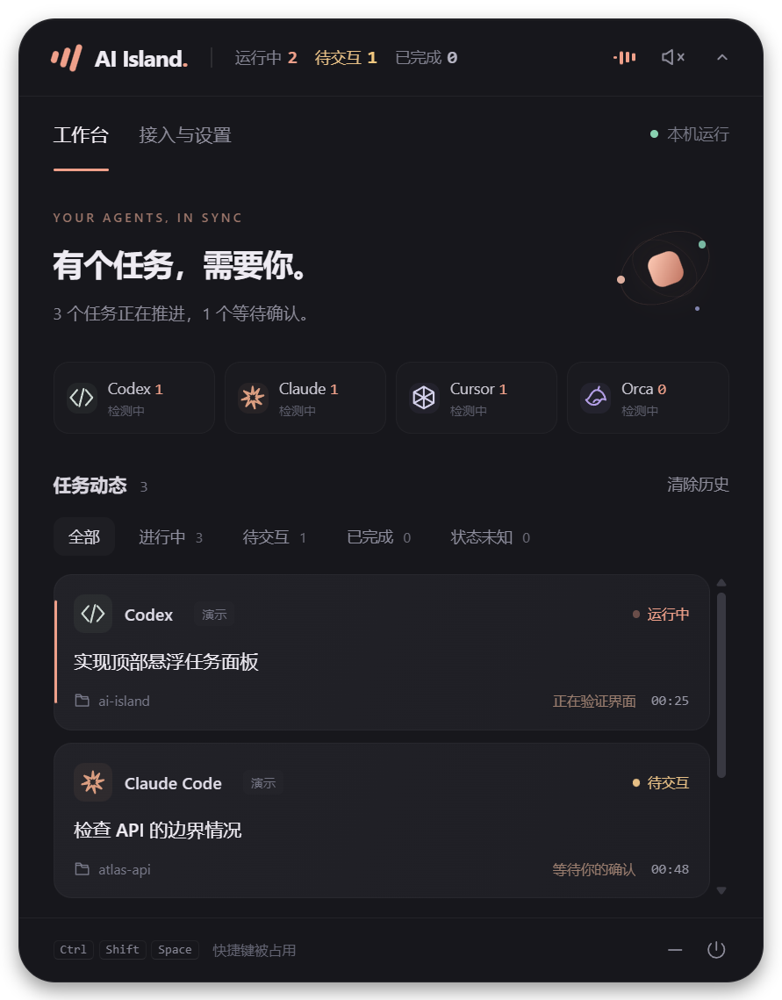

# AI Island

[English](README.md) | **简体中文**

在 Windows 屏幕顶部查看 AI 编程任务。收起是一颗小胶囊，展开是按会话组织的任务面板；真实任务完成时播放双音提示。

支持同时监控多个会话，显示运行中、待交互、已完成和状态未知数量；任务卡片顺序固定。通过 Orca 启动的 Codex / Claude 统一归入 Orca。



## 运行

从 [GitHub Releases](https://github.com/kunpengdai/ai-island/releases/latest) 下载 Windows x64 便携包，完整解压后运行 `AI Island.exe`。运行时需要保留同目录的文件。便携版不需要安装 Node.js；目前仅支持 Windows。

本地构建的输出为 `release/AI-Island-0.1.4-win-x64/AI Island.exe`，分发包为 `release/AI-Island-0.1.4-win-x64.zip`。从旧版 Agent Island 升级时保留原有接入、设置和历史。

开发环境需要 Node.js 22 或更新版本：

```powershell
npm ci
npm start
```

点击胶囊展开 / 收起；拖动左侧图标可移动窗口。`Ctrl+Shift+Space` 切换展开状态，`Esc` 收起。右下角系统托盘菜单可以恢复窗口、重置位置或退出。设置中可切换显示器、音量、置顶、系统通知和开机启动。开机启动仅供打包版本使用，移动便携版后需重新启用。

小窗口始终显示 **运行中 / 待交互 / 已完成** 三组数量。运行中不包含待交互，完成数量保留到你清除历史或该会话开始下一轮任务。展开后可单独筛选“待交互”。

无法确认当前状态的任务归入独立的“状态未知”分类，并显示数量；“全部”视图也会在列表底部单独分区。它们不计入运行中、待交互或已完成。收到新的可靠任务事件后，会自动恢复到对应分类。

运行中的任务保持固定顺序，工具活动和耗时更新只修改原卡片，不整排重建或重新排序。点击工具卡片可筛选对应任务，再点一次恢复全部。通过 Orca 启动的 Codex 等 Agent 统一归属 **Orca**，卡片标明实际 Agent 类型。

## 接入工具

| 工具 | 接入方式 | 使用步骤 |
| --- | --- | --- |
| Orca | 自动轮询本机 `orca worktree ps --json`，间隔 3 秒 | 打开 Orca 即可；读取终端 Agent 的真实状态 |
| Codex Desktop | 自动读取 `~/.codex/sessions` 中桌面会话的生命周期记录 | 无需安装钩子、重启 Codex 或中断现有任务；每秒增量读取，每 5 秒发现新会话 |
| Codex CLI | 用户级 `~/.codex/hooks.json` | 在“接入与设置”中点击“接入”，重启 Codex，并在 `/hooks` 中审核和信任新增的 Island 钩子 |
| Claude Code | 用户级 `~/.claude/settings.json` | 点击“接入”，重启 Claude Code；如工具要求审核钩子，在工具内完成审核 |
| Cursor | 用户级 `~/.cursor/hooks.json` | 点击“接入”，重启 Cursor，运行本机 Agent 对话 |
| Cursor Cloud / Background Agent | Cursor Cloud Agents API v1 | 在设置的云端连接区输入你在 Cursor 控制台生成的 API Key，验证后自动同步 |

每次安装、移除接入都会在原文件旁保存带时间戳的 `.island-backup-*` 备份。配置是合并写入的；移除只删除 Island 的钩子，保留其他钩子和设置。JSON 损坏时拒绝覆盖。当前支持工具的默认配置目录；使用独立 profile、`CODEX_HOME`、`CLAUDE_CONFIG_DIR`、WSL 或自定义安装路径时需要另行适配。

Orca 内的 Codex / Claude 归在 Orca 分组，并在卡片上标明 Codex / Claude Code。通过 Orca 启动且包含 pane/worktree 标识的钩子会合并到同一任务；独立工具通过各自会话 ID 区分。同一个工具多个会话可同时显示。终端退出后仍会读取近期明确的完成状态，避免完成被当成失联。

“已安装 / 等待事件”只说明钩子配置存在。桌面版发现有效桌面会话后显示“已连接”；钩子在实际收到事件后显示“已连接”。检测到进程并不代表有任务。应用不会扫描屏幕或模拟键盘。

桌面兼容适配只读本地 JSONL，识别 Codex Desktop / vscode 来源并排除 CLI 和子代理，避免与 Orca 任务重复。开始、完成、失败、中断均以明确的生命周期事件判断；不会把一段回复文字当作任务结束。阻塞式 `request_user_input` 记为待交互，收到匹配回答后恢复运行。未写入日志的权限弹窗暂不能可靠识别。会话日志并非稳定的公开 API，后续 Codex 更新可能需要调整适配。

Cursor 的“本机已就绪”表示本机进程与钩子已就绪，提交新任务后才能确认收到任务事件。Cloud / Background Agent 运行在远端，不会触发 Windows 本机钩子。云端连接使用 [Cursor 官方 API](https://cursor.com/docs/cloud-agent/api/endpoints)，每 10 秒通过 GET 同步已有 Agent 和最新 Run；仅 Run 的 `FINISHED` 记为完成，失败、取消和过期分别处理，不把 Agent 的 `IDLE` 当作成功。等待后台工作仍属运行中，云端 API 当前没有提供明确的用户交互等待状态。

云端 API Key 只在主进程中使用，通过 Windows 凭据加密后保存在用户数据目录的 `cursor-cloud-key.bin`，不会回传到页面或写入任务历史。点击“断开云端”会删除已保存的 Key；错误或断网时显示未知，不播放成功提示。需要你在应用设置里提供自己的 Key 后才能验证真实云端连接。

## 状态与提醒

- **正在开始**：用户提交任务。
- **运行中**：收到工具事件或 Orca 的 working 状态。
- **等你确认**：收到权限请求等明确等待事件。Cursor 当前仅报告开始、工具活动和结束，不能保证识别权限等待。
- **已完成**：收到 Stop / stop 或 Orca 的 done；仅从已观测到的活动状态转入完成时响铃。
- **运行失败 / 已中断**：工具明确报告失败或中断，不播放成功提示。
- **状态未知**：连接断开、会话消失、无法识别的状态或独立钩子 30 分钟无事件，不推测任务成功。恢复事件后可继续更新。

启动时加载的旧事件和首次 Orca 快照不响铃；重复结束事件不重复响铃。提示音由应用内 Web Audio 合成，可关闭或调节音量。系统通知默认关闭。演示任务明确标注“演示”，不会保存为真实历史。

当前 Orca 适配依赖 CLI 返回的终端 Agent / live PTY 字段；没有这些字段的内嵌 Chat、远程或云端任务不会被当成已支持。关闭 Island 后仍可运行编程工具；钩子只落盘事件，不会等待 Island 或干预工具决策。

## 本机数据

钩子脚本与临时事件放在 `%LOCALAPPDATA%\AgentIsland`，无需监听网络端口。任务事件包含工具、会话 ID、状态、工作目录、模型、工具名和最多 160 字的任务标题；不保存工具参数、工具输出或完整对话。事件消费后删除；过期事件忽略。关闭应用期间事件会暂存在本机，重新启动后清理。

新用户的设置和最近 80 个非活动任务保存在 `%APPDATA%\AI Island`。检测到旧版数据目录 `%APPDATA%\Agent Island` 时会继续使用它，避免升级丢失设置与历史。钩子运行目录仍使用原来的 `AgentIsland` 名称，已安装的工具钩子无需重装。桌面适配逐行解析本地日志，仅保留会话 ID、状态、时间、目录和任务短标题，不保存对话正文或工具参数。点击“清除历史”删除非活动任务，已清除的旧状态不会被下一次轮询重新加入；移除接入后可以自行删除上述本机数据目录。历史中的任务标题可能来自你的输入，请按本机项目数据对待。

应用没有遥测，也不会上传本地任务。启用 Orca 时会调用本机 CLI；显式连接 Cursor 云端后会请求 Cursor 官方 API。公开源码和便携包不包含开发者的工具配置、任务历史、日志或凭据。

## 开发与验证

```powershell
npm test       # 状态机、失联、重复事件、配置合并/备份、实际 PowerShell 钩子
npm run check  # JavaScript 语法检查
npm run smoke  # Electron 原生窗口、界面流程、声音 IPC、截图
npm run pack   # Windows 应用目录
npm run dist   # Windows 便携 ZIP
node scripts/smoke.cjs --packaged  # 验证便携版
```

Electron 冒烟测试使用独立临时目录，不修改真实工具配置，不查询用户任务。截图输出到 `artifacts/`。首次安装依赖需要下载 Electron。构建脚本直接打包 Electron 运行时，不需要额外的打包服务。

参考官方文档：[Codex Hooks](https://learn.chatgpt.com/docs/hooks)、[Claude Code Hooks](https://code.claude.com/docs/en/hooks)、[Cursor Hooks](https://cursor.com/docs/hooks)、[Electron 窗口 API](https://www.electronjs.org/docs/latest/api/browser-window)。Orca 适配根据本机安装版本的 `orca skills get orca-cli --json` 和 `orca worktree ps --help` 实现。

## 参与开发

欢迎提交 Issue 和 Pull Request。反馈接入问题时请说明 Windows、AI Island 和对应工具版本，以及任务从桌面应用、终端还是 Orca 启动。请勿公开上传任务历史、会话日志、API Key 或未脱敏的诊断文件。提交修改前运行 `npm test`、`npm run check` 和 `npm run smoke`。

可选的 [Windows CI 配置示例](docs/windows-ci.yml) 包含测试、打包和便携版冒烟验证。仓库维护者可将它放入 `.github/workflows/windows.yml` 后启用；通过 GitHub CLI 上传工作流需要具备相应的工作流写入权限。

本项目以 [MIT License](LICENSE) 开源，与 OpenAI、Anthropic、Cursor 或 Orca 没有官方隶属关系。
